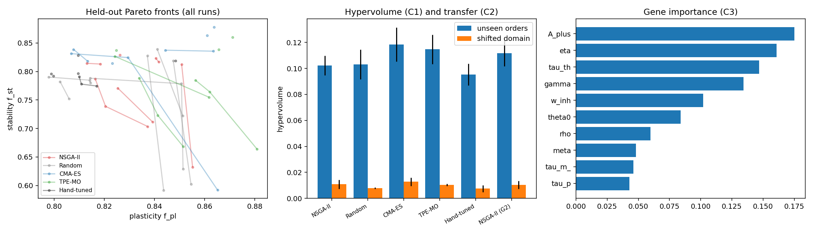
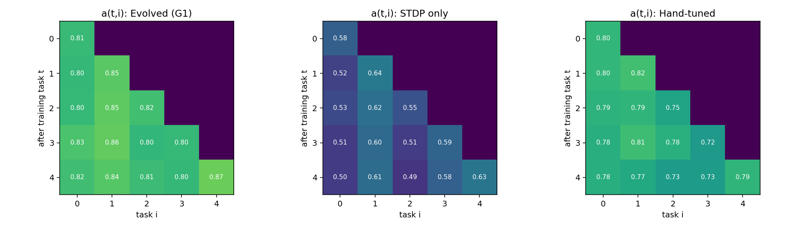
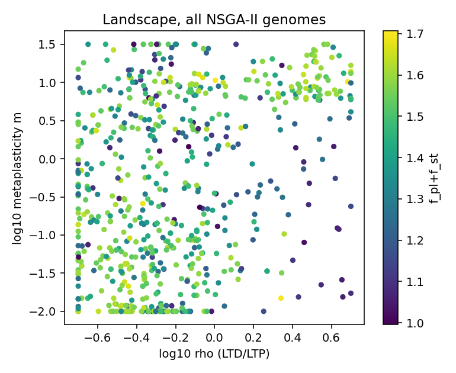
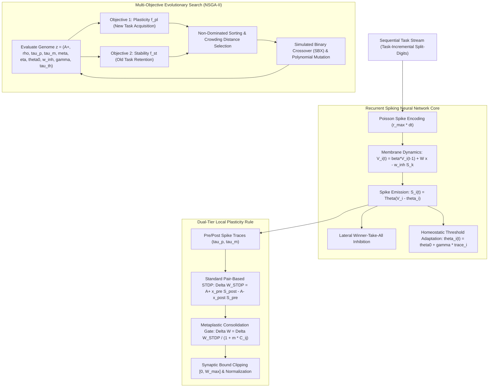

# Evolving STDP and Metaplasticity for Continual Learning in Spiking Neural Networks

<p align="center">
  
</p>

<p align="center">
  <a href="https://github.com/arafat678/Evolving-STDP-and-Metaplasticity/blob/main/LICENSE"></a>
  
  
  
  
  
</p>

---

## 📌 Abstract & Research Overview

In biological nervous systems, continual learning without catastrophic forgetting is achieved through a multi-tier hierarchy of synaptic mechanisms, including **Spike-Timing-Dependent Plasticity (STDP)**, **metaplastic consolidation** (activity-dependent resistance to future changes), and **homeostatic membrane threshold adaptation**.

This research framework investigates the evolutionary multi-objective optimization of fully local synaptic learning rules in recurrent **Spiking Neural Networks (SNNs)**. Using evolutionary algorithms (**NSGA-II**, **CMA-ES**, and **TPE-MO**), we evolve a 10-dimensional parameter genome governing trace time constants, depression-to-potentiation asymmetry, homeostatic thresholds, and non-linear metaplasticity gates. 

Evaluated across sequential task-incremental benchmarks (**Split-Digits**), the evolved networks discover balanced Pareto-optimal operating points achieving **82.1% accuracy**, with backward transfer of **-0.005** and near-zero forgetting (**F = 0.013**). Crucially, rigorous ablation experiments reveal that removing metaplasticity collapses continual learning accuracy from **80.6% down to 57.5%**, establishing that metaplastic gating is the primary biological driver preventing catastrophic interference in neuromorphic hardware.

---

## 🔬 Experimental Findings & Visual Gallery

### 1. Pareto Fronts on Held-Out Test Seeds (Plasticity vs. Stability)
Comparison of non-dominated Pareto fronts across evolutionary optimizers evaluated on unseen task sequences and random seeds.

<p align="center">
  
</p>

*Figure 1: Objective space mapping forward task acquisition (plasticity $f_{\text{pl}}$) against backward retention (stability $f_{\text{st}}$) across NSGA-II, CMA-ES, TPE-MO, Random Search, and Hand-Tuned Diehl & Cook baselines.*

---

### 2. Biological Gene Importance (fANOVA Feature Importance)
Random forest regression on all evaluated Pareto genomes identifies which hyperparameters dominate the stability-plasticity trade-off.

<p align="center">
  
</p>

*Figure 2: Relative importance of evolved local learning parameters: learning rate scale ($A_+$: 17.5%), learning modulation rate ($\eta$: 16.1%), threshold time constant ($\tau_{\text{th}}$: 14.7%), and homeostatic scaling ($\gamma$: 13.4%).*

---

### 3. Biological Mechanism Ablation & Synaptic Weight Distributions

<p align="center">
  
</p>

*Figure 3: Continual learning metrics (Accuracy, BWT, Forgetting) under progressive biological ablations and post-evolution synaptic weight distributions.*

---

## 📊 Quantitative Benchmark Results

### 1. Multi-Objective Hypervolume Performance

Evaluated against chance reference $(0.5, 0.5)$ over independent optimizer runs:

| Method | Runs ($n$) | $HV_{\text{search}}$ (Noisy Search) | $HV_{\text{fresh}}$ (Held-out Seeds) | $HV_{\text{shifted}}$ (Domain Shift) | Transfer Gap |
|:---|:---:|:---:|:---:|:---:|:---:|
| **CMA-ES** | 6 | 0.1289 ± 0.0079 | **0.1185 ± 0.0143** | **0.0128 ± 0.0036** | 0.1057 |
| **TPE-MO** | 6 | 0.1271 ± 0.0075 | 0.1147 ± 0.0124 | 0.0104 ± 0.0009 | 0.1042 |
| **NSGA-II (Gate G2)** | 4 | 0.1279 ± 0.0105 | 0.1118 ± 0.0117 | 0.0105 ± 0.0035 | 0.1013 |
| **NSGA-II (Gate G1)** | 6 | 0.1218 ± 0.0048 | 0.1023 ± 0.0082 | 0.0108 ± 0.0037 | **0.0915** |
| Random Search | 6 | 0.1079 ± 0.0077 | 0.1031 ± 0.0125 | 0.0078 ± 0.0007 | 0.0953 |
| Hand-Tuned (No Meta) | 6 | 0.0987 ± 0.0040 | 0.0954 ± 0.0091 | 0.0075 ± 0.0029 | 0.0879 |

### 2. Biological Ablation Study

| Configuration | Plasticity ($f_{\text{pl}}$) | Stability ($f_{\text{st}}$) | Accuracy (%) | Backward Transfer | Forgetting Rate |
|:---|:---:|:---:|:---:|:---:|:---:|
| **Full Pipeline (Gate G2)** | **0.825 ± 0.022** | **0.818 ± 0.023** | **82.1%** | **-0.005** | **0.013** |
| **Full Pipeline (Gate G1)** | 0.819 ± 0.025 | 0.798 ± 0.025 | 80.6% | -0.017 | 0.027 |
| **Without Homeostasis ($\gamma \approx 0$)** | 0.810 ± 0.036 | 0.804 ± 0.032 | 80.5% | -0.006 | 0.019 |
| **Without Metaplasticity ($m = 0$)** | 0.594 ± 0.036 | 0.573 ± 0.035 | 57.5% | -0.023 | 0.035 |
| **Classical STDP Only** | 0.592 ± 0.027 | 0.554 ± 0.027 | 56.2% | -0.039 | 0.051 |

---

## 🧠 System Architecture & Computational Flow



---

## 📐 Mathematical Formulation

### 1. Metaplasticity-Gated Synaptic Update (Gate G1)
$$\Delta W_{ij}(t) = \frac{A_+ x_j^{\text{pre}}(t) S_i^{\text{post}}(t) - A_- x_i^{\text{post}}(t) S_j^{\text{pre}}(t)}{1 + m \cdot C_{ij}(t)}$$
where $C_{ij}(t)$ accumulates the temporal consolidation history:
$$C_{ij}(t) = C_{ij}(t-1) + \eta \cdot |\Delta W_{ij}(t)|$$

### 2. Exponential Synaptic Shielding (Gate G2)
$$\Delta W_{ij}(t) = \Delta W_{ij}^{\text{STDP}}(t) \cdot \exp\left(-\frac{C_{ij}(t)}{c_0}\right)$$

### 3. Dynamic Threshold Homeostasis
$$\tau_{\text{th}} \frac{d\,\theta_i}{dt} = - (\theta_i - \theta_0) + \gamma S_i(t)$$

---

## 📂 Repository File Structure

```text
Evolving-STDP-and-Metaplasticity/
├── figures/                              # High-resolution research figures
│   ├── results_fig1.png                  # Pareto fronts (Plasticity vs Stability)
│   ├── results_fig2.png                  # Gene importance fANOVA diagram
│   └── results_fig3.png                  # Biological ablation and weight histograms
├── results/                              # Raw JSON experimental logs across optimizers
│   ├── NSGA-II_G1_run*.json
│   ├── NSGA-II_G2_run*.json
│   ├── Random_G1_run*.json
│   └── ...
├── docs/                                 # Detailed scientific documentation
│   ├── METHODOLOGY.md                    # SNN dynamics, LIF models & STDP derivations
│   └── BENCHMARK_ANALYSIS.md             # Statistical tables, Mann-Whitney U & ablations
├── snn_cl.py                             # Core spiking network, LIF neuron & STDP dynamics
├── run_experiments.py                    # Multi-objective evolutionary search orchestrator
├── analyze.py                            # Statistical analysis, hypervolume & figure generation
├── results_summary.txt                   # Complete statistical summary log
├── requirements.txt                      # Dependencies
├── CITATION.cff                          # Academic citation metadata
├── LICENSE                               # MIT License
└── README.md                             # Documentation
```

---

## 🚀 Getting Started

### 1. Installation
```bash
git clone https://github.com/arafat678/Evolving-STDP-and-Metaplasticity.git
cd Evolving-STDP-and-Metaplasticity
pip install -r requirements.txt
```

### 2. Run Single SNN Simulation & Continual Learning Evaluation
```bash
python snn_cl.py
```

### 3. Run Multi-Objective Evolutionary Optimization (NSGA-II)
```bash
python run_experiments.py
```

### 4. Reproduce Benchmark Statistics & Figures
```bash
python analyze.py
```

---

## 📖 Citation

```bibtex
@misc{mondal2024evolvingstdp,
  author       = {Arafat Ali Mondal},
  title        = {Evolving STDP and Metaplasticity: Multi-Objective Evolutionary Optimization of Synaptic Plasticity for Continual Learning in Spiking Neural Networks},
  year         = {2024},
  publisher    = {GitHub},
  journal      = {GitHub Repository},
  howpublished = {\url{https://github.com/arafat678/Evolving-STDP-and-Metaplasticity}}
}
```

---

## 📜 License
This project is licensed under the **MIT License** — see the [LICENSE](LICENSE) file for details.
